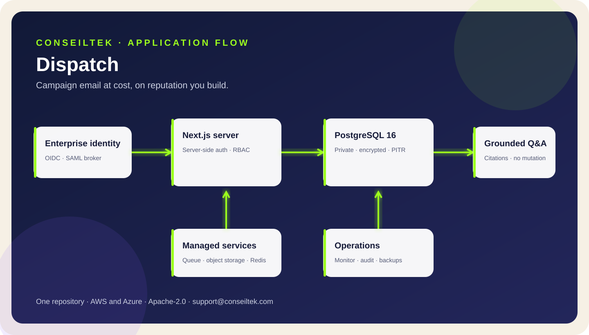

<p align="center"></p>
<h1 align="center">Dispatch</h1>
<p align="center"><strong>Campaign email at cost, on reputation you build.</strong></p>

[](https://github.com/ConseilTek-Tektons/dispatch/actions/workflows/ci.yml) [](https://github.com/ConseilTek-Tektons/dispatch/actions/workflows/codeql.yml) [](LICENSE)

Dispatch is a deployable self-hosted campaign-email control plane for audiences, templates, approvals, delivery events, and suppression. It is a ConseilTek Techtons reference implementation for teams evaluating an owned alternative to Mailchimp and Klaviyo. Read the [product rationale and honest parity matrix](https://conseiltek.com/techtons/dispatch) before production adoption.



## Working scope

- Audience lists and segmentation
- Template versioning and approval
- Provider-neutral send orchestration
- Bounce, complaint, and suppression handling
- Domain reputation dashboards
- PostgreSQL-backed email_campaign records with a server-authorised /api/campaigns read/create workflow
- Configurable feature RBAC, OIDC for Okta, Microsoft Entra ID, and Duo, plus SAML through the included broker pattern
- Grounded Q&A using permission-filtered local knowledge and optional OpenAI file search; no agent or mutation layer

## Important boundary

Dispatch is not an email-delivery network. Amazon SES, Azure Communication Services, or another provider still sends mail and governs network reputation limits.

## Run locally

```bash
cp .env.example .env.local
docker compose up -d postgres redis keycloak
pnpm install --frozen-lockfile
pnpm db:migrate && pnpm db:seed
pnpm dev
```

Open http://localhost:3000. Demo personas are available only when AUTH_DEMO_MODE=true.

## Deploy

One repository contains both supported cloud paths:

- infra/aws: AWS App Runner, Aurora PostgreSQL Serverless v2, ElastiCache Serverless, S3, SQS, Secrets Manager, KMS, and CloudWatch through Terraform
- infra/azure: Azure App Service Web App for Containers, PostgreSQL Flexible Server, Azure Managed Redis, Blob Storage, Storage Queue, Key Vault, and Monitor through Bicep

Dispatch requires server-side routes, PostgreSQL transactions, SSO callbacks, RBAC enforcement, and AI retrieval. Static website hosting is not an appropriate runtime. Managed/serverless services reduce operating maintenance while preserving an application server and database boundary.

## Documentation

[Architecture](docs/ARCHITECTURE.md) · [Authentication](docs/AUTHENTICATION.md) · [RBAC](docs/RBAC.md) · [AI](docs/AI.md) · [Security](docs/SECURITY.md) · [Operations](docs/OPERATIONS.md)

Dispatch is designed, built, and maintained by [ConseilTek](https://conseiltek.com) under Apache 2.0. Contact [support@conseiltek.com](mailto:support@conseiltek.com).
